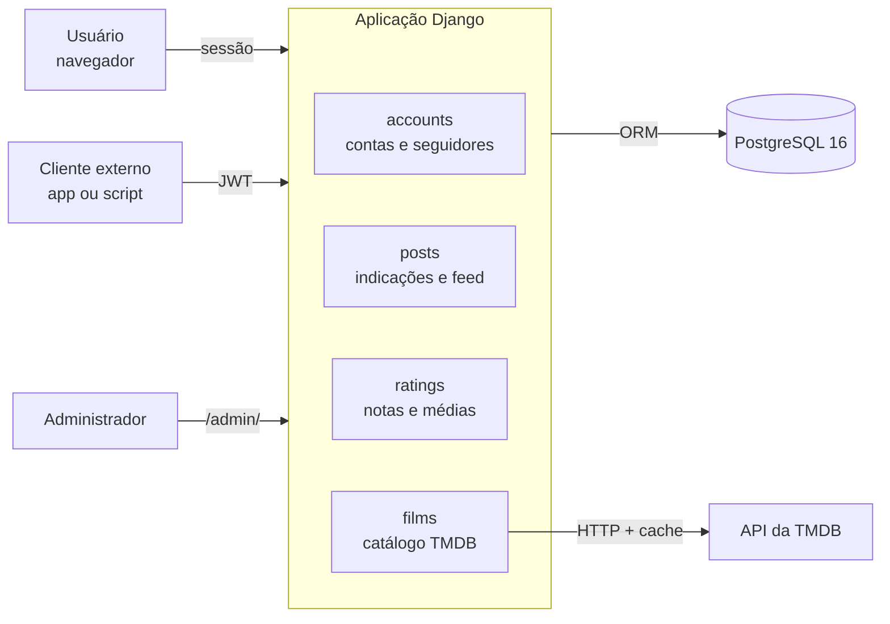

# 🎬 CineClub

Rede social para cinéfilos: indique filmes e séries, siga outras pessoas, curta, comente e avalie títulos, com dados do catálogo vindos da [TMDB](https://www.themoviedb.org/).

[](https://github.com/TallysCesarGB/2026-ifrn-ads-dsw-integrador-1/actions)
[](https://github.com/cookiecutter/cookiecutter-django/)
[](https://github.com/astral-sh/ruff)

Projeto Integrador I do curso de **Análise e Desenvolvimento de Sistemas** do **IFRN — Campus Pau dos Ferros**.

## Equipe

| Integrante | Módulo | Responsabilidade |
|---|---|---|
| Tallys Cesar Gurgel Batista | Núcleo e Contas (`config/`, `accounts`) | Configuração do projeto, cadastro, login, perfil, seguidores, autenticação JWT da API |
| Paulo Kennedy | Indicações e Feed (`posts`) + Infraestrutura | Indicações, feed, curtidas, comentários, recomendações, dados de demonstração, Docker, CI e deploy |
| Hector | Catálogo e Avaliações (`films`, `ratings`) | Integração com a TMDB, página do título, trailer, onde assistir, notas e rankings |

## Funcionalidades

- Cadastro e login por e-mail e senha; perfil com foto, bio e contadores.
- Seguir e deixar de seguir usuários; busca de usuários.
- Indicar filmes e séries (busca na TMDB) com comentário.
- Feed das pessoas seguidas, com curtidas, comentários e recomendações.
- Página do título com sinopse, elenco, trailer e onde assistir no Brasil.
- Notas de 0 a 10 e média da comunidade.
- Rankings em formato de *stories*: em alta no Brasil e no mundo, lançamentos, mais indicados e mais bem avaliados no CineClub.
- API REST com JWT e documentação OpenAPI (Swagger e Redoc).

## Arquitetura

O CineClub é um **monolito Django** gerado com o [cookiecutter-django](https://github.com/cookiecutter/cookiecutter-django). Uma única aplicação atende o site (Django Templates + JavaScript sem frameworks, autenticado por sessão) e a API REST (Django REST Framework, autenticada por JWT).



| App | Responsabilidade | Tabelas |
|---|---|---|
| `accounts` | Perfil (`Profile`), seguir (`Follow`), login, cadastro e API de usuários | `Profile`, `Follow` |
| `posts` | Indicações, curtidas, comentários, recomendações, feed | `Post`, `Like`, `Comment`, `Recommendation` |
| `films` | Camada de serviço da TMDB (busca, detalhes, trailer, streaming, rankings) com cache | nenhuma |
| `ratings` | Notas dos usuários por título | `Rating` |
| `cineclub.users` | Modelo de usuário do template (`users.User`) | `User` |

Os dados de filmes e séries não são guardados no banco: são consultados na TMDB e mantidos em cache.

## Stack

| Camada | Tecnologia |
|---|---|
| Linguagem e framework | Python 3.14, Django 6.0 |
| API | Django REST Framework, SimpleJWT, drf-spectacular |
| Interface | Django Templates, CSS e JavaScript sem frameworks |
| Banco de dados | PostgreSQL 16 |
| Ambiente | Docker Compose, uv, WhiteNoise, Gunicorn (produção) |
| Qualidade | pytest, pytest-django, pytest-mock, pre-commit (ruff, djLint), GitHub Actions |
| Dados externos | API v3 da TMDB |

## Estrutura do repositório

```text
.
├── config/                  # settings (base, local, production, test) e urls.py
├── cineclub/
│   ├── users/               # modelo de usuário do template
│   ├── templates/           # templates do site
│   └── static/              # css/ e js/
├── accounts/                # contas, perfis e seguidores
├── posts/                   # indicações e feed (+ comando seed_demo_data)
├── films/                   # integração com a TMDB
├── ratings/                 # avaliações
├── fixtures/demo_data.json  # dados de demonstração
├── compose/                 # Dockerfiles de desenvolvimento e produção
├── .envs/                   # variáveis de ambiente por ambiente
├── docker-compose.local.yml
├── docker-compose.production.yml
├── justfile                 # atalhos de comandos
├── pyproject.toml / uv.lock # dependências
├── conftest.py              # fixtures de teste compartilhadas
└── manage.py
```

## Rodando localmente com Docker

Pré-requisitos: Git, [Docker Desktop](https://docs.docker.com/get-docker/), [pre-commit](https://pre-commit.com/) e, opcionalmente, [just](https://just.systems/).

```bash
# 1. Clonar e instalar os hooks de formatação
git clone https://github.com/TallysCesarGB/2026-ifrn-ads-dsw-integrador-1.git cineclub
cd cineclub
pre-commit install

# 2. Configurar a chave da TMDB (gratuita em https://www.themoviedb.org/settings/api)
cp .envs/.local/.tmdb.example .envs/.local/.tmdb
# edite .envs/.local/.tmdb e preencha TMDB_API_KEY

# 3. Buildar e subir Django + PostgreSQL
export COMPOSE_FILE=docker-compose.local.yml
docker compose build
docker compose up -d

# 4. Criar as tabelas e carregar os dados de demonstração
docker compose run --rm django python manage.py migrate
docker compose run --rm django python manage.py loaddata fixtures/demo_data.json

# 5. (opcional) Criar um superusuário para o /admin/
docker compose run --rm django python manage.py createsuperuser
```

Acesse **http://localhost:8000**. Usuário de demonstração: **demo@cineclub.com** / **cineclub123** (os demais usuários da fixture usam a senha `senha123456`).

> ⚠️ A chave da TMDB fica só em `.envs/.local/.tmdb`, que está no `.gitignore`. Nunca a coloque em `.envs/.local/.django`, que é versionado.

### Atalhos com `just`

```bash
just build              # builda as imagens
just up                 # sobe os containers em segundo plano
just down               # derruba os containers
just logs               # logs em tempo real
just manage <comando>   # qualquer comando do manage.py (ex.: just manage migrate)
just pytest             # roda os testes
```

## Testes

```bash
just pytest
# ou
docker compose run --rm django pytest
```

Os testes cobrem models, views e API dos quatro apps. As chamadas à TMDB são simuladas com `pytest-mock`, então a suíte roda sem internet e sem chave da TMDB.

## Rotas do site

| Rota | Descrição |
|---|---|
| `/` | Feed com stories e indicações |
| `/accounts/login/` | Login e criação de conta |
| `/accounts/perfil/<username>/` | Perfil, indicações, editar perfil, seguir |
| `/indicar/` | Nova indicação (busca na TMDB) |
| `/filmes/<media_type>/<tmdb_id>/` | Detalhes do filme/série, avaliar, onde assistir |
| `/admin/` | Administração Django |

## API REST

Autenticação por JWT: faça login em `/api/v1/auth/token/` e envie `Authorization: Bearer <access>` nas demais chamadas.

| Rota | Descrição |
|---|---|
| `POST /api/v1/auth/register/` | Criar conta |
| `POST /api/v1/auth/token/` | Login (e-mail + senha) → par de tokens JWT |
| `POST /api/v1/auth/token/refresh/` | Renovar o token de acesso |
| `GET /api/v1/auth/me/` | Dados do usuário autenticado (inclui o e-mail) |
| `GET /api/v1/users/search/?q=` | Buscar usuários (sem e-mail) |
| `GET /api/v1/users/<username>/` | Perfil público (sem e-mail) |
| `POST/DELETE /api/v1/users/id/<id>/follow/` | Seguir / deixar de seguir |
| `GET/POST /api/v1/posts/` | Linha do tempo pública / criar indicação |
| `GET /api/v1/feed/` | Feed do usuário autenticado |
| `POST /api/v1/posts/<id>/like/` | Curtir / descurtir |
| `POST /api/v1/posts/<id>/recommend/` | Recomendar |
| `GET/POST /api/v1/posts/<id>/comments/` | Comentários |
| `GET /api/v1/films/search/?q=&type=` | Buscar filme/série na TMDB |
| `GET /api/v1/films/<media_type>/<id>/` | Detalhes do título |
| `GET /api/v1/films/rankings/<categoria>/` | Rankings (`movies`, `series`, `world`, `upcoming`, `app`, `rated`) |
| `GET /api/v1/streaming/<media_type>/<id>/` | Onde assistir |
| `POST /api/v1/ratings/` | Avaliar |
| `GET /api/v1/ratings/<id>/` | Nota média |
| `GET /api/v1/ratings/<id>/me/` | Minha nota |

Documentação interativa: **Swagger** em `/api/docs/` e **Redoc** em `/api/redoc/`.

```bash
curl -X POST http://localhost:8000/api/v1/auth/token/ \
  -H "Content-Type: application/json" \
  -d '{"email": "demo@cineclub.com", "password": "cineclub123"}'
```

## Fluxo de trabalho (Git)

- `main`: versão estável, apresentada à banca.
- `develop`: integração; toda branch nova sai daqui.
- `feature/<nome>`, `fix/<nome>`, `docs/<nome>`, `chore/<nome>`: uma por tarefa, mesclada na `develop` por Pull Request revisado por outro integrante.
- O CI (GitHub Actions) roda o pre-commit e os testes em todo PR e push para `develop` e `main`.

## Deploy

Planejado para a **AWS**, em uma instância EC2 com `docker-compose.production.yml` (Django com Gunicorn, PostgreSQL e Traefik com HTTPS, gerados pelo template). Antes de publicar, preencha `.envs/.production/` (nunca versionado) com uma `DJANGO_SECRET_KEY` nova, o domínio em `DJANGO_ALLOWED_HOSTS` e a `TMDB_API_KEY`.

## Licença

MIT. Dados de filmes e séries fornecidos pela TMDB; este produto usa a API da TMDB, mas não é endossado nem certificado por ela.
